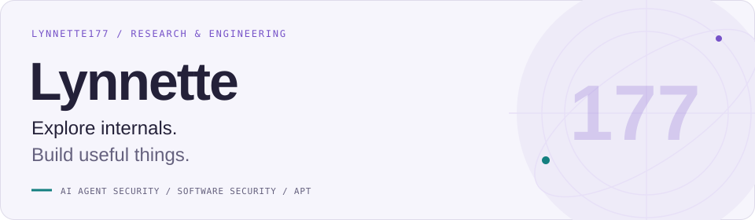
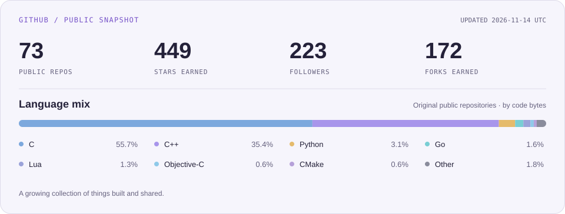

<picture>
  <source media="(prefers-color-scheme: dark)" srcset="assets/header-dark.svg">
  
</picture>

  <b>Direct-entry Ph.D. Student · UCAS ZGCLAB</b> 
  AI Agent Security &nbsp; / &nbsp; Software Security &nbsp; / &nbsp; Advanced Persistent Threats

### About me

I'm a direct-entry Ph.D. student jointly trained by the **University of Chinese Academy of Sciences (UCAS)** and **ZGCLAB**. I received my bachelor's degree in **Cybersecurity** from **Beijing University of Posts and Telecommunications (BUPT)**.

My research focuses on **AI agent security**, **software security**, and **advanced persistent threats (APTs)**. I also build tools for reverse engineering, mobile instrumentation, and everyday automation.

### Selected work

| Project | What it does |
| :--- | :--- |
| **[GirlHook](https://github.com/Lynnette177/GirlHook)** &nbsp; `C++` `Lua` | A Lua-scriptable Android ART hook framework for dynamic instrumentation. |
| **[jbnjb-hook-framework](https://github.com/Lynnette177/jbnjb-hook-framework)** &nbsp; `Objective-C++` | An iOS function hooking framework for jailbroken and non-jailbroken environments. |
| **[Unfairplayed](https://github.com/Lynnette177/Unfairplayed)** &nbsp; `Python` `macOS` | A native macOS toolkit for iOS app decryption, IPA management, injection, and debugging. |

<a href="https://github.com/Lynnette177?tab=repositories">Explore all repositories →</a>

### Open source, in numbers

<picture>
  <source media="(prefers-color-scheme: dark)" srcset="assets/overview-dark.svg">
  
</picture>
